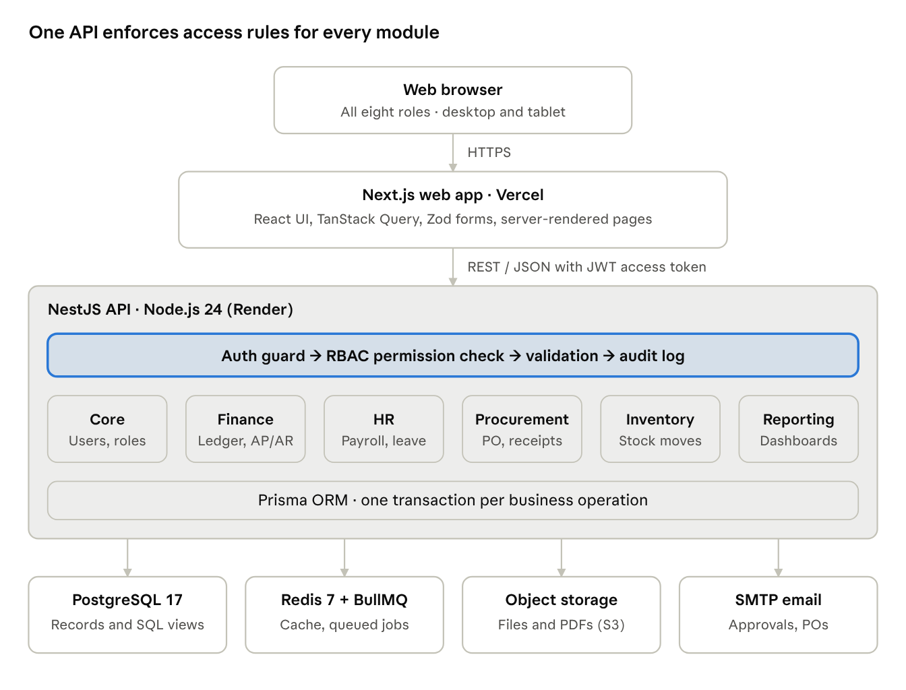
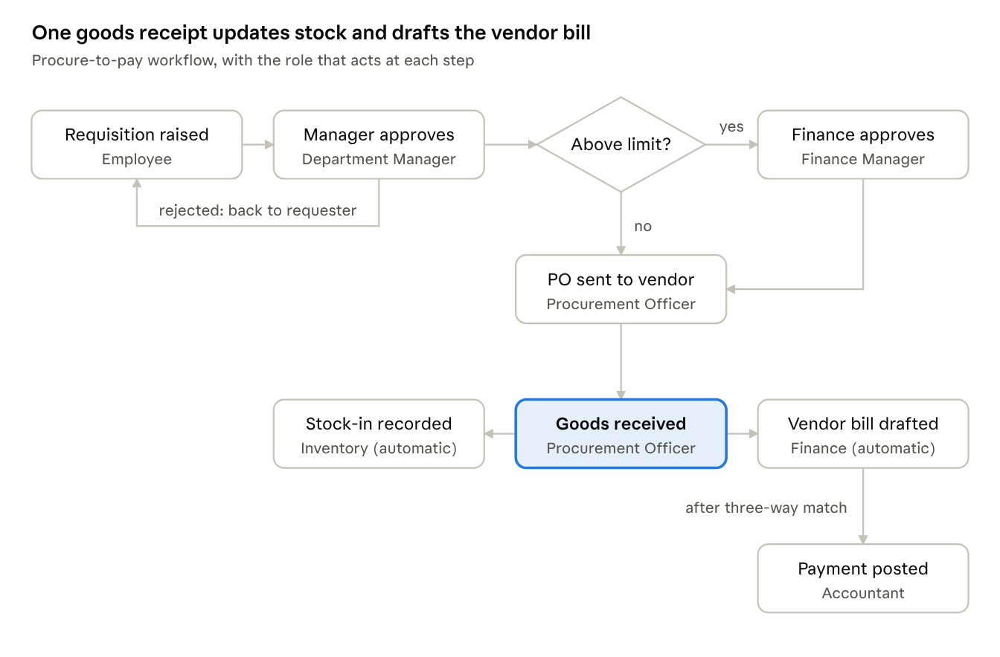
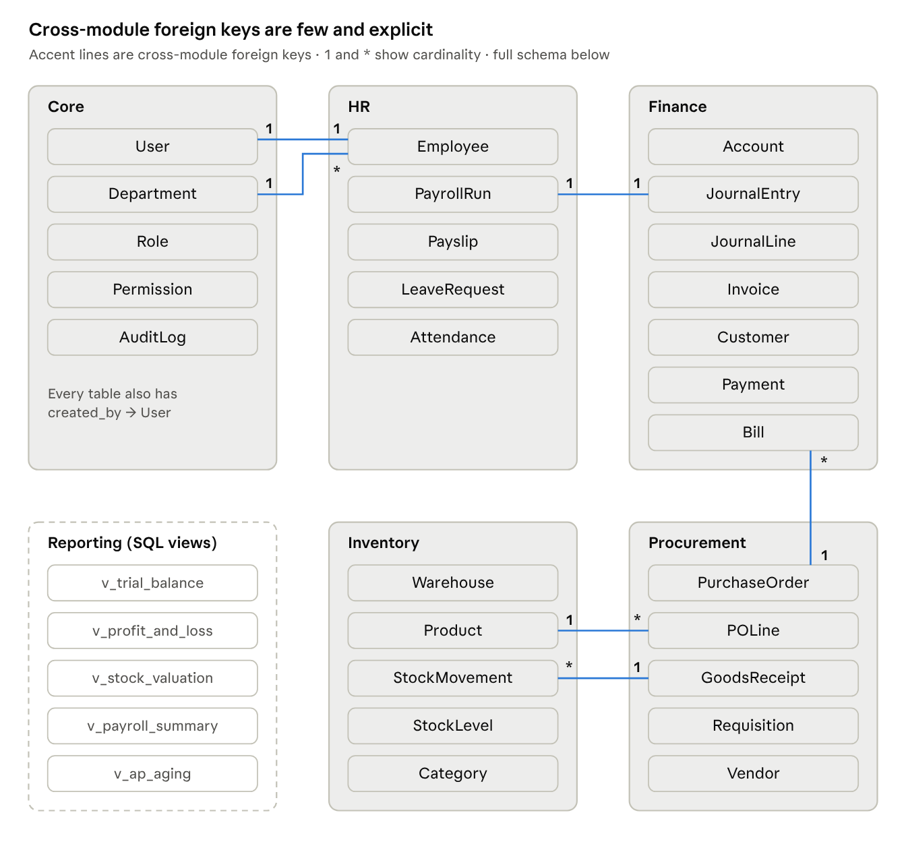
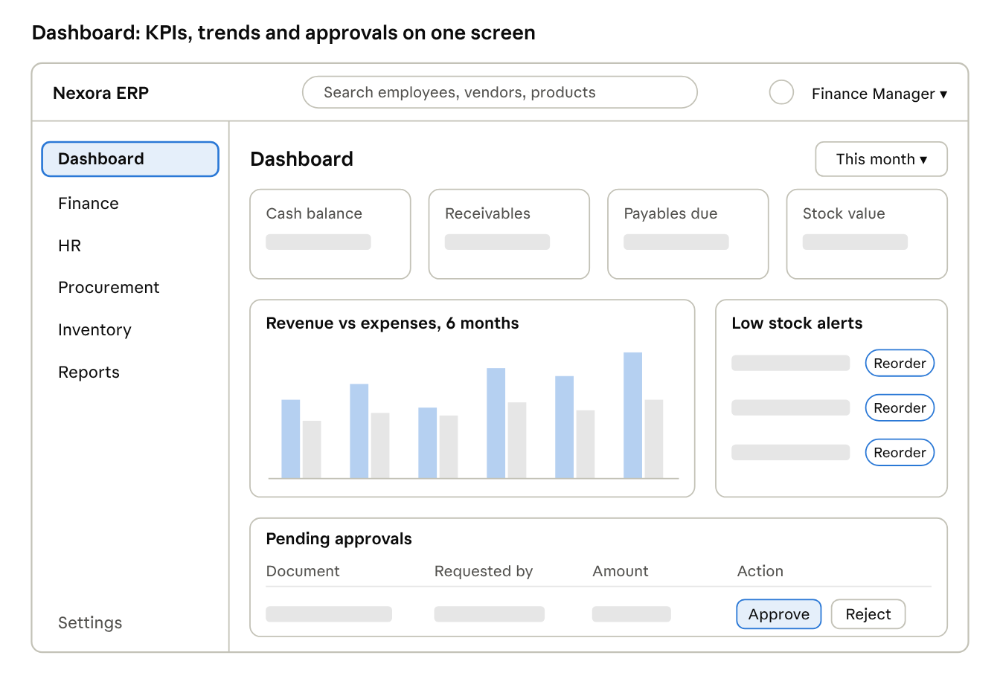
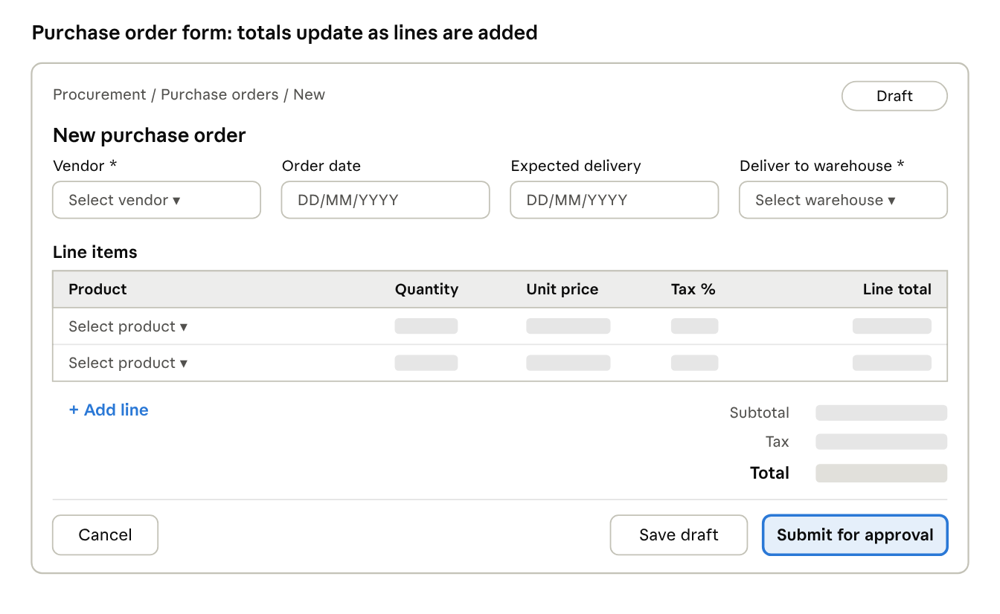
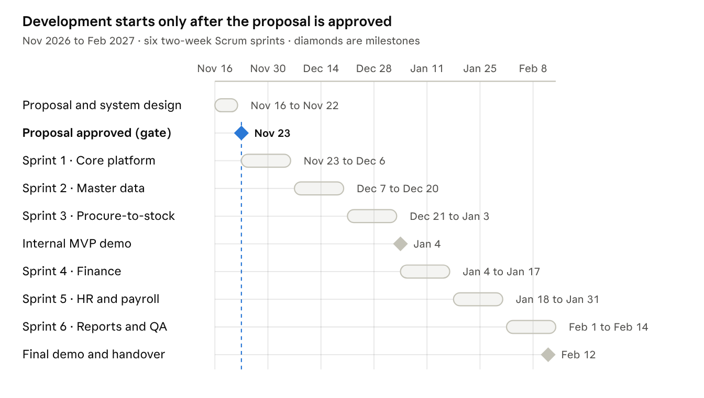

# Nexora ERP

Enterprise resource planning platform for small and mid-sized businesses. Nexora brings **finance, HR, procurement, inventory and reporting** into one web application with a shared database, role-based access control and an audit trail on every business record.

> **Status:** Week 1. The proposal and system design have been submitted for review; feature development starts in Sprint 1 after approval. The repository already contains every document and configuration the proposal describes.

| | |
| --- | --- |
| **Work arrangement** | Remote internship |
| **Category** | Business management software |
| **Timeline** | 16 Nov 2026 to 14 Feb 2027 (13 weeks, six 2-week sprints) |
| **Stack** | Next.js · NestJS · PostgreSQL · Prisma · Redis · Docker |

## Documents

| Document | Contents |
| --- | --- |
| [Proposal and system design (PDF)](docs/Nexora-ERP-Proposal-and-System-Design.pdf) | The full submission document |
| [Proposal and system design (Markdown)](docs/proposal.md) | Same content, readable on GitHub |
| [Architecture](docs/architecture.md) | Components, module boundaries, request lifecycle, workflows, deployment |
| [Database design and ERD](docs/erd.md) | Module overview, cross-module keys, detailed ERDs, design rules |
| [Architecture decision records](docs/adr/README.md) | Modular monolith, technology stack, authentication and RBAC |
| [Contributing guide](CONTRIBUTING.md) | Setup, branching, commit convention, PR workflow, definition of done |
| [Changelog](CHANGELOG.md) | Release notes |
| [Sprint retrospectives](docs/retros.md) | One entry per sprint |

## Contents

1. [Overview and objectives](#1-overview-and-objectives)
2. [Scope](#2-scope)
3. [Requirements](#3-requirements)
4. [Modules and features](#4-modules-and-features)
5. [Roles and permissions](#5-roles-and-permissions)
6. [Technology stack and tools](#6-technology-stack-and-tools)
7. [Architecture and workflows](#7-architecture-and-workflows)
8. [Database design](#8-database-design)
9. [UI/UX wireframes](#9-uiux-wireframes)
10. [Methodology and timeline](#10-methodology-and-timeline)
11. [Version control](#11-version-control)
12. [Getting started](#12-getting-started)
13. [Repository structure](#13-repository-structure)

## 1. Overview and objectives

Growing businesses run finance, payroll, purchasing and stock in separate tools. Data is re-keyed, numbers disagree between departments, and managers cannot see the state of the business without manual consolidation. Nexora replaces those tools with one system and one source of truth.

**Objectives**

1. Deliver five integrated modules (Finance, HR, Procurement, Inventory, Reporting) on one shared database and one login.
2. Automate cross-module flows: an approved purchase order raises stock on receipt and posts a payable to the ledger without re-entry.
3. Enforce role-based access control so each user sees and changes only what their role allows.
4. Give managers a live dashboard of key metrics (cash, payables, receivables, stock value, headcount).
5. Ship a tested, documented, deployed MVP with a clean Git history and CI pipeline.

**Success criteria:** all Must requirements pass their acceptance tests · p95 API response under 500 ms with 10,000 records per module · at least 70% backend test coverage · a live demo reviewers can open.

## 2. Scope

| In scope (MVP) | Out of scope (future phases) |
| --- | --- |
| Single organisation, multiple departments and users | Multi-company / multi-tenant consolidation |
| One base currency, configurable tax rates | Multi-currency and revaluation |
| Chart of accounts, journals, invoices, bills, payments | Bank feeds and automatic reconciliation |
| Employees, leave, attendance, payroll (gross to net) | Country-specific statutory payroll filing |
| Vendors, requisitions, purchase orders, goods receipt | Vendor portal and e-procurement bidding |
| Products, warehouses, stock movements, reorder alerts | Barcode scanning, manufacturing / BOM |
| Dashboards, standard reports, CSV/PDF export | Custom report builder, AI forecasting |
| Responsive web app (desktop and tablet) | Native mobile apps |
| Email notifications for approvals | SMS, WhatsApp, Slack integrations |

Payments are recorded, not processed; all demo data is synthetic.

## 3. Requirements

**Functional (22, prioritised with MoSCoW)**

| Module | Must | Should / Could |
| --- | --- | --- |
| Core | Sign-in with access and refresh tokens (FR-01); user, role and department admin (FR-02); audit log of every change (FR-03) | Approval notifications (FR-21); global search (FR-22) |
| Finance | Chart of accounts and balanced double-entry journals (FR-04); invoices, bills, payments (FR-05); trial balance, P&L, balance sheet (FR-06) | Fiscal period locking (FR-07) |
| HR | Employee profiles (FR-08); leave requests and approval (FR-09); attendance and monthly payroll with payslips (FR-10) | Payroll posts to Finance (FR-11) |
| Procurement | Vendors and requisitions with approval (FR-12); purchase orders emailed to vendors (FR-13); goods receipt creating vendor bills (FR-14) | — |
| Inventory | Products, categories, units, warehouses (FR-15); stock in/out/transfer/adjust with running balances (FR-16) | Reorder alerts (FR-17); weighted-average valuation (FR-18) |
| Reporting | Role-specific dashboard (FR-19); filterable reports with CSV/PDF export (FR-20) | — |

**Non-functional**

| Category | Target |
| --- | --- |
| Performance | p95 API under 500 ms; dashboard loads in under 2 s |
| Scalability | Stateless API; 200 concurrent users on one small instance |
| Security | Argon2 password hashing, HTTPS only, OWASP Top 10 mitigations, rate-limited auth |
| Authorisation | Permissions checked server-side on every endpoint |
| Data integrity | Financial postings in transactions; posted journals only reversed, never edited |
| Availability | 99.5% uptime for the demo; daily database backups |
| Usability | Responsive from 768 px; WCAG 2.1 AA contrast and keyboard navigation |
| Maintainability | TypeScript end to end, linted, at least 70% backend coverage |
| Observability | Structured JSON logs, request IDs, error tracking, health check |
| Portability | Local stack starts with one `docker compose up` |

Full requirement list: [proposal, section 3](docs/proposal.md#3-functional-and-non-functional-requirements).

## 4. Modules and features

| Module | Key features |
| --- | --- |
| Core / Admin | Login, refresh tokens, users, roles and permissions, departments, company settings, audit log, notifications, file uploads |
| Finance | Chart of accounts, journal entries, invoices, bills, payments, tax rates, fiscal periods, trial balance, P&L, balance sheet |
| HR | Employee directory, leave, attendance, salary structures, payroll runs, payslip PDFs |
| Procurement | Vendors, requisitions with approval, purchase orders, goods receipt, three-way match |
| Inventory | Products, categories, units, warehouses, stock movements, reorder alerts, weighted-average valuation |
| Reporting | Role-based dashboards, KPI cards and charts, standard reports, CSV and PDF export |

**Cross-module integrations:** goods receipt → stock-in movement and draft vendor bill · payroll run → salary journal · stock adjustment → inventory gain/loss journal · reporting reads every module through SQL views.

## 5. Roles and permissions

Permissions take the form `module:action` (e.g. `procurement:approve`), are granted to roles, and are checked by the API on every request.

| Role | Main responsibilities |
| --- | --- |
| Super Admin | Company settings, users, roles, full access, audit log |
| Finance Manager | Approves bills and payments, closes periods, all financial reports |
| Accountant | Posts journals, invoices, bills, payments |
| HR Manager | Manages employees, approves leave, runs payroll |
| Procurement Officer | Manages vendors, creates POs, records goods receipt |
| Inventory Manager | Manages products and warehouses, moves and adjusts stock |
| Department Manager | Raises and approves requisitions and leave for their team |
| Employee | Own profile and payslips, leave requests, requisitions |

**Permission matrix** (C create · R read · U update · D delete · A approve)

| Module | Super Admin | Finance Mgr | Accountant | HR Mgr | Procurement | Inventory Mgr | Dept Mgr | Employee |
| --- | --- | --- | --- | --- | --- | --- | --- | --- |
| Users and roles | CRUD | R | — | R | — | — | — | — |
| Finance | CRUDA | CRUDA | CRU | — | R (bills) | — | — | — |
| HR: employees | CRUD | R | — | CRUD | — | — | R (team) | R (own) |
| HR: leave | CRUDA | — | — | CRUDA | — | — | A (team) | CR (own) |
| HR: payroll | CRUDA | R | — | CRUDA | — | — | — | R (own payslip) |
| Procurement | CRUDA | RA (above limit) | R | — | CRU | R | CA (team) | C (requisition) |
| Inventory | CRUD | R | R | — | R | CRUD | R | — |
| Reports | All | Finance, summaries | Finance | HR | Procurement | Inventory | Team | Own |
| Audit log | R | R (finance) | — | R (HR) | — | — | — | — |

Rules: requisitions above a set amount also need Finance Manager approval · nobody approves their own request (segregation of duties) · roles are data, so new roles need no code change.

## 6. Technology stack and tools

| Layer | Technology |
| --- | --- |
| Frontend | Next.js 16 (App Router), React 19, TypeScript 5, Tailwind CSS 4, shadcn/ui |
| Data and forms | TanStack Query, TanStack Table, React Hook Form, Zod, Recharts, Zustand |
| Backend | NestJS 11 on Node.js 24 LTS, REST + OpenAPI (Swagger) |
| Database and ORM | PostgreSQL 17, Prisma 6 |
| Jobs and cache | Redis 7 + BullMQ |
| Auth | JWT access token (15 min) + rotating refresh token (httpOnly cookie), Argon2 |
| Files and email | S3-compatible storage (MinIO locally), SMTP via Nodemailer (Mailpit locally) |
| PDF generation | Puppeteer |
| Testing | Jest, Supertest, Playwright |
| Code quality | ESLint, Prettier, Husky, lint-staged, Commitlint |
| DevOps | Docker Compose, GitHub Actions, CodeQL, Dependabot |
| Hosting | Vercel (web), Render (API, PostgreSQL, Redis) |
| Monitoring | Sentry, Pino |
| Design and planning | Figma, dbdiagram.io, GitHub Projects and Issues, VS Code |

Rationale: [ADR 0002](docs/adr/0002-technology-stack.md).

## 7. Architecture and workflows

A modular monolith: one web app, one API, one database. Every request passes the same authentication, RBAC, validation and audit chain before reaching a module.



The goods receipt is the main integration point between modules:



Other workflows (request lifecycle, leave approval, payroll run, period close): [docs/architecture.md](docs/architecture.md).

## 8. Database design

One PostgreSQL database in third normal form; each module owns its tables and only six business foreign keys cross module boundaries.



Detailed ERDs with every table's columns, plus the design rules (UUID keys, decimal money, immutable postings, audit columns): [docs/erd.md](docs/erd.md).

## 9. UI/UX wireframes

Every screen shares one app shell (top bar, module sidebar, content area). The dashboard adapts to the signed-in role; forms validate inline and show the document's workflow status.





Screen inventory and design principles: [proposal, section 9](docs/proposal.md#9-uiux-wireframes-and-interface-design).

## 10. Methodology and timeline

Agile Scrum with two-week sprints: sprint planning, daily async stand-up, sprint review with the mentor, and a retrospective logged in [docs/retros.md](docs/retros.md).



| Sprint | Deliverables | Exit criteria |
| --- | --- | --- |
| Week 1 | Proposal, system design, ERD, wireframes | Proposal approved |
| Sprint 1 | Monorepo, Docker, CI, schema, auth, RBAC, user admin, audit log, app shell | Users see only menus their role allows |
| Sprint 2 | Master data: departments, employees, vendors, customers, products, warehouses | All master data can be created, searched and edited |
| Sprint 3 | Requisitions, purchase orders, goods receipt, stock movements, reorder alerts | Requisition-to-stock works end to end (internal MVP demo) |
| Sprint 4 | Chart of accounts, journals, invoices, bills, payments, statements | Trial balance balances; P&L and balance sheet generate |
| Sprint 5 | Leave, attendance, payroll run, payslips, payroll journal | Payroll for 50 employees posts to the ledger |
| Sprint 6 | Dashboards, reports, exports, E2E tests, security checks, production deploy | All Must requirements pass; final demo |

**Definition of done:** reviewed and merged · CI green · endpoints documented in Swagger · deployed to staging.

## 11. Version control

| Branch | Purpose |
| --- | --- |
| `main` | Production-ready code, tagged per release (`v0.1.0`, `v0.2.0`, …) |
| `develop` | Integration branch for the current sprint; deploys to staging |
| `feature/<issue-id>-<short-name>` | One issue or user story, branched from `develop` |
| `fix/<issue-id>-<short-name>` | Bug fix during a sprint |
| `hotfix/<short-name>` | Urgent production fix from `main` |

- Commits follow [Conventional Commits](https://www.conventionalcommits.org/) (`feat(procurement): add goods receipt form`), checked by Commitlint.
- Every change reaches `develop` through a pull request that passes CI and gets one approval.
- Dependabot keeps dependencies current; CodeQL scans every push; CODEOWNERS assigns reviewers.
- Secrets live only in GitHub Actions secrets and local `.env` files (never committed).

Details: [CONTRIBUTING.md](CONTRIBUTING.md).

## 12. Getting started

**Prerequisites:** Node.js 24 (`.nvmrc`), pnpm 9 (`corepack enable`), Docker.

```bash
git clone https://github.com/naitik-raj17/nexora-erp.git
cd nexora-erp
corepack enable
pnpm install          # installs dependencies and Git hooks
cp .env.example .env
pnpm db:up            # PostgreSQL 17, Redis 7, MinIO, Mailpit
```

| Script | What it does |
| --- | --- |
| `pnpm dev` | Run web and API in watch mode |
| `pnpm build` | Build all packages |
| `pnpm lint` / `pnpm typecheck` / `pnpm test` | Quality checks (also run in CI) |
| `pnpm format` | Format the codebase with Prettier |
| `pnpm db:up` / `pnpm db:down` | Start or stop the local services |

| Local service | URL |
| --- | --- |
| Web app | http://localhost:3000 |
| API and Swagger docs | http://localhost:4000/docs |
| MinIO console | http://localhost:9001 |
| Mailpit inbox | http://localhost:8025 |

The web app, API and seed data (with demo login credentials) arrive in Sprint 1.

## 13. Repository structure

```
nexora-erp/
├── apps/
│   ├── web/                 # Next.js frontend (Sprint 1)
│   └── api/                 # NestJS backend (Sprint 1)
├── packages/
│   ├── shared/              # Zod schemas and types shared by web and api
│   └── config/              # Shared ESLint, TypeScript and Prettier presets
├── prisma/                  # Schema, migrations, seed data (Sprint 1)
├── docs/
│   ├── Nexora-ERP-Proposal-and-System-Design.pdf
│   ├── proposal.md
│   ├── architecture.md
│   ├── erd.md
│   ├── retros.md
│   ├── adr/                 # Architecture decision records
│   └── images/              # Diagrams and wireframes
├── .github/
│   ├── workflows/           # CI and CodeQL
│   ├── ISSUE_TEMPLATE/
│   ├── pull_request_template.md
│   ├── CODEOWNERS
│   └── dependabot.yml
├── .husky/                  # Git hooks (lint-staged, commitlint)
├── docker-compose.yml
├── .env.example
├── package.json · pnpm-workspace.yaml · turbo.json
├── CONTRIBUTING.md
├── CHANGELOG.md
└── README.md
```

## Author

**Naitik Raj** — [@naitik-raj17](https://github.com/naitik-raj17)
