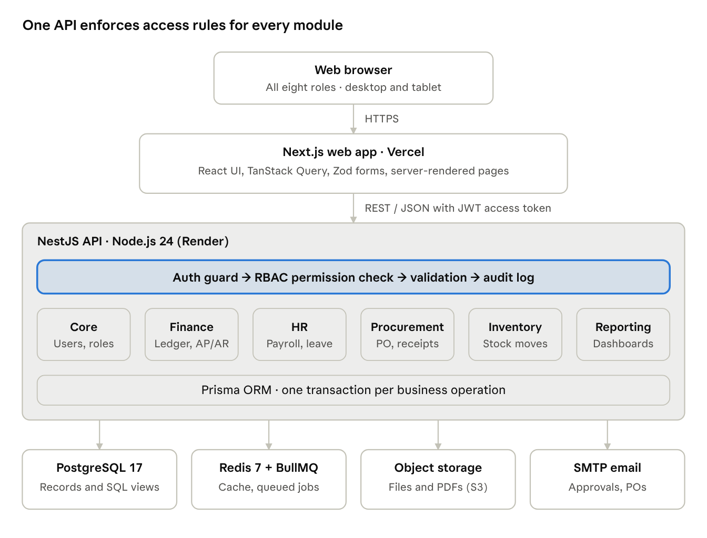
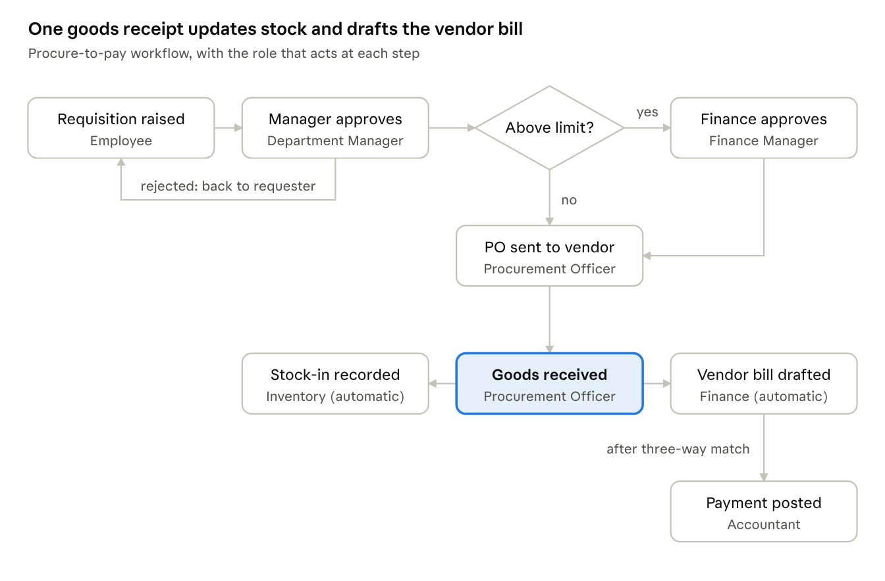

# System architecture

Nexora is a **modular monolith**: one Next.js web app calls one NestJS API over REST, and every request passes the same authentication and RBAC guard before it reaches a business module.

## Components

| Component | Technology | Responsibility |
| --- | --- | --- |
| Web app | Next.js 16, React 19 (Vercel) | UI for all roles, server-rendered pages, form validation with Zod |
| API | NestJS 11 on Node.js 24 (Render) | REST endpoints, business rules, authentication and authorisation |
| Guard chain | NestJS guards and interceptors | JWT check → RBAC permission check (`module:action`) → validation → audit log |
| Modules | Core, Finance, HR, Procurement, Inventory, Reporting | Each owns its tables, services and endpoints |
| Data access | Prisma ORM | Type-safe queries; one transaction per business operation |
| Database | PostgreSQL 17 | Business records, audit log, reporting views |
| Jobs and cache | Redis 7 + BullMQ | Payroll runs, PDF generation, emails, caching, token revocation |
| Object storage | S3-compatible (MinIO locally) | Employee documents, attachments, generated PDFs |
| Email | SMTP (Mailpit locally) | Approval notifications, purchase orders to vendors |

## Module boundaries

- A module talks to another module only through its exported service, never by querying its tables.
- Cross-module effects happen inside one database transaction (for example, a goods receipt updates stock and drafts the vendor bill together).
- Reporting reads through SQL views and never writes.
- Any module can be split into its own service later if load requires it.

## Request lifecycle

1. The browser sends the request with the access token; an expired token is refreshed using the httpOnly refresh cookie.
2. The auth guard verifies the token; the RBAC guard checks the user's permission for the route (e.g. `inventory:update`).
3. Zod validates the body; the module service runs the business rules inside a database transaction.
4. The audit interceptor records the change; the API returns JSON.

## Key workflows

### Procure to pay

The goods receipt is the integration point: one confirmed receipt raises stock in the chosen warehouse and drafts the vendor bill, which is paid only after the PO, receipt and bill match (three-way match).

### Leave approval

1. Employee submits a leave request; the system checks the remaining balance.
2. The Department Manager is notified and approves or rejects.
3. Approved leave reduces the balance and appears in attendance and payroll.

### Monthly payroll run

1. HR Manager starts a run for the month; a background job calculates earnings, deductions and net pay.
2. HR Manager reviews and confirms; payslip PDFs are generated and employees are notified.
3. Confirmation posts a salary journal entry to Finance (salary expense debit, payable credit).

### Period close

1. Accountant reviews the trial balance; Finance Manager locks the fiscal period.
2. Locked periods reject new postings; corrections are made as reversing entries in the open period.

## Deployment

| Environment | Web | API, database, Redis | Trigger |
| --- | --- | --- | --- |
| Local | `pnpm dev` | `docker compose up -d` | Manual |
| Staging | Vercel preview | Render (staging) | Merge to `develop` |
| Production | Vercel | Render | Merge to `main` (tagged release) |

Related decisions: [ADR 0001](adr/0001-modular-monolith.md), [ADR 0002](adr/0002-technology-stack.md), [ADR 0003](adr/0003-authentication-and-rbac.md).
