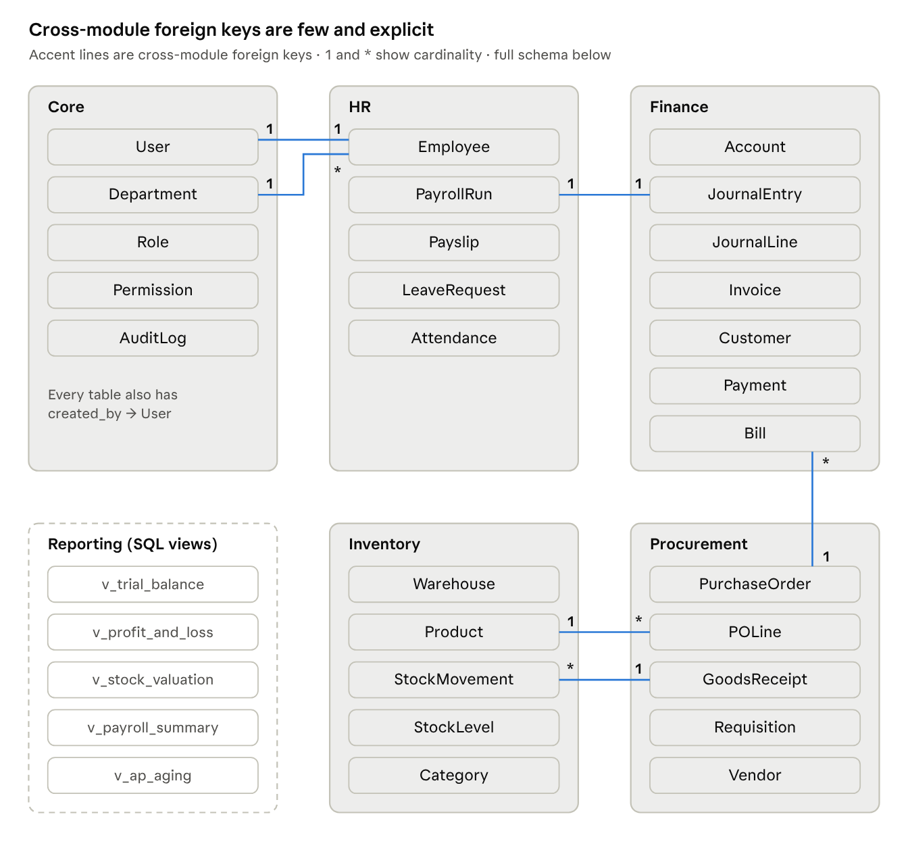
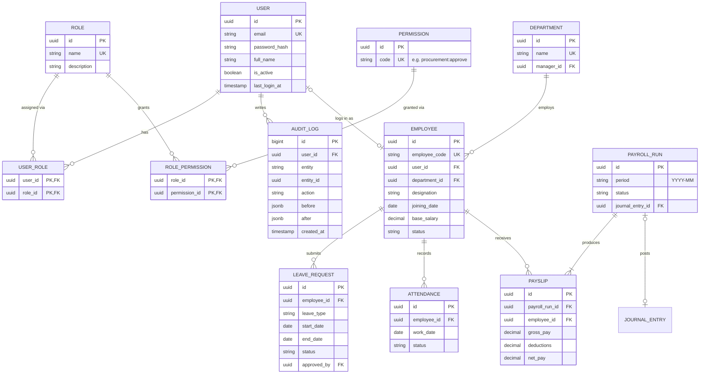
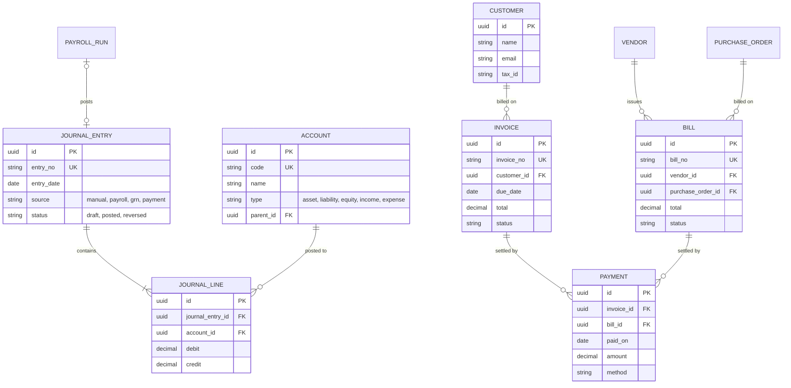
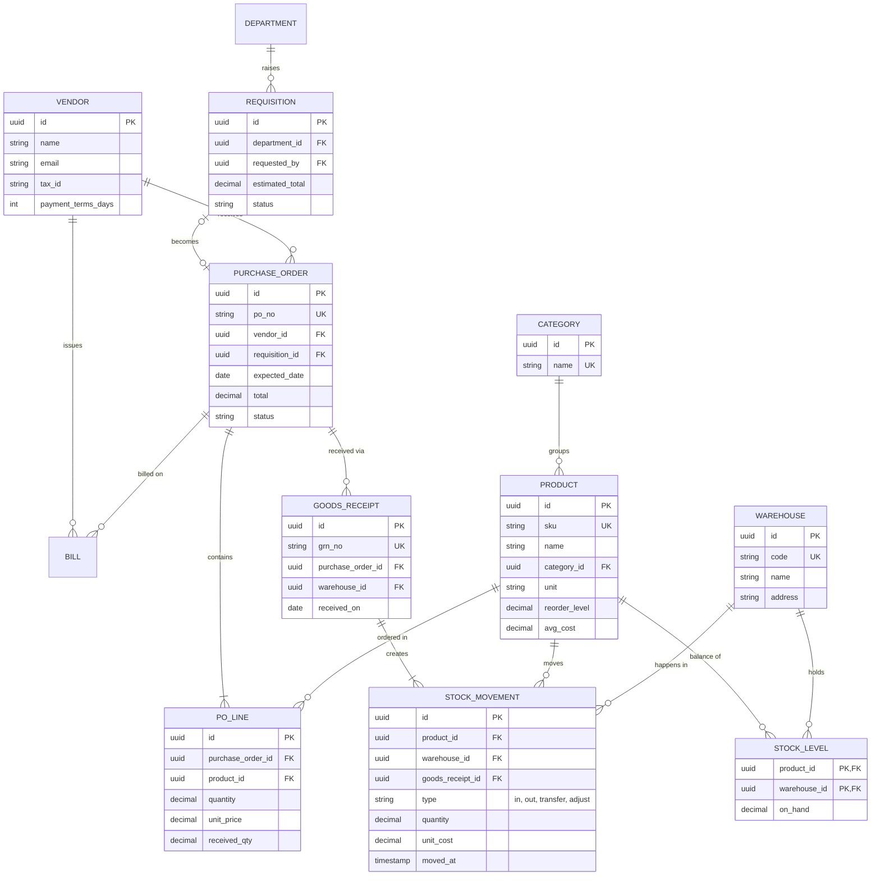

# Database design and ERD

Nexora uses one PostgreSQL 17 database in third normal form. Each module owns its own group of tables, and only six business foreign keys cross module boundaries (plus the `created_by` and `updated_by` audit columns that point to `USER`).

## Module overview

| Module | Tables |
| --- | --- |
| Core | `USER`, `ROLE`, `PERMISSION`, `USER_ROLE`, `ROLE_PERMISSION`, `DEPARTMENT`, `AUDIT_LOG` |
| HR | `EMPLOYEE`, `LEAVE_REQUEST`, `ATTENDANCE`, `PAYROLL_RUN`, `PAYSLIP` |
| Finance | `ACCOUNT`, `JOURNAL_ENTRY`, `JOURNAL_LINE`, `CUSTOMER`, `INVOICE`, `BILL`, `PAYMENT` |
| Procurement | `VENDOR`, `REQUISITION`, `PURCHASE_ORDER`, `PO_LINE`, `GOODS_RECEIPT` |
| Inventory | `CATEGORY`, `PRODUCT`, `WAREHOUSE`, `STOCK_MOVEMENT`, `STOCK_LEVEL` |
| Reporting | SQL views only: `v_trial_balance`, `v_profit_and_loss`, `v_stock_valuation`, `v_payroll_summary`, `v_ap_aging` |

## Cross-module relationships

| From | To | Cardinality | Meaning |
| --- | --- | --- | --- |
| `EMPLOYEE.user_id` | `USER` | 1 : 1 | An employee may have a login |
| `EMPLOYEE.department_id` | `DEPARTMENT` | many : 1 | Every employee belongs to one department |
| `PAYROLL_RUN.journal_entry_id` | `JOURNAL_ENTRY` | 1 : 1 | A confirmed payroll run posts one salary journal |
| `BILL.purchase_order_id` | `PURCHASE_ORDER` | many : 1 | Vendor bills are matched to a purchase order |
| `PO_LINE.product_id` | `PRODUCT` | many : 1 | Each order line buys one product |
| `STOCK_MOVEMENT.goods_receipt_id` | `GOODS_RECEIPT` | many : 1 | A goods receipt creates stock-in movements |

## Detailed ERD

The detailed ERD is split by module so each diagram stays readable. Tables owned by another module appear without columns.

## Core and HR

## Finance

## Procurement and Inventory

## Design rules

| Rule | Detail |
| --- | --- |
| Keys | UUID primary keys (UUID v7 for index-friendly ordering); human-readable numbers such as `PO-2026-0001` in separate unique columns |
| Money and quantities | `NUMERIC(14,2)` for money, `NUMERIC(14,3)` for quantities; never floating point |
| Common columns | Every table has `created_at`, `updated_at`, `created_by`, `updated_by`; master data has `deleted_at` for soft delete |
| Double entry | A database check plus a service rule: the sum of debits equals the sum of credits for every posted journal entry |
| Immutability | Posted journals, payslips and stock movements are never updated; corrections are reversing records |
| Stock balances | `STOCK_LEVEL` is updated in the same transaction as each `STOCK_MOVEMENT`, so on-hand quantity is always consistent |
| Indexes | Foreign keys, status columns and date columns used in report filters (e.g. `journal_entry.entry_date`, `stock_movement.moved_at`) |
| Migrations | Versioned Prisma migrations committed to Git; the seed script loads roles, permissions, a chart of accounts and demo data |
