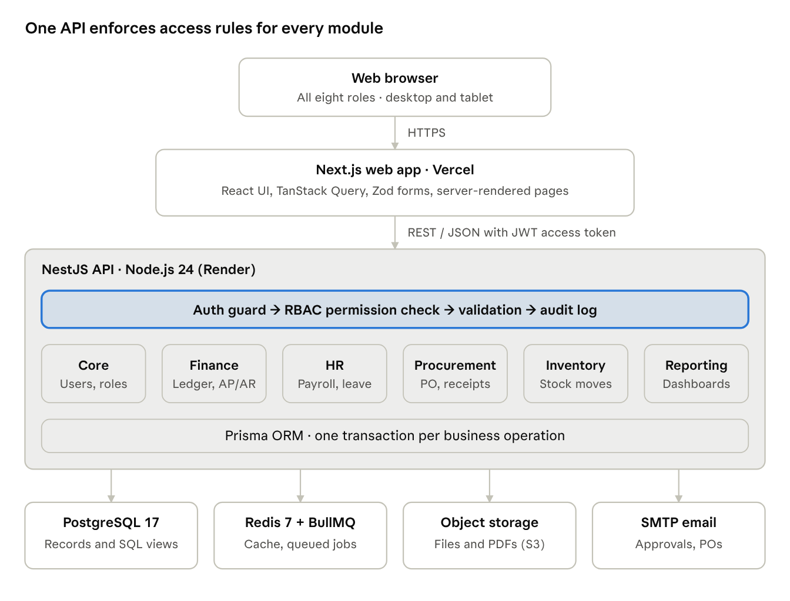
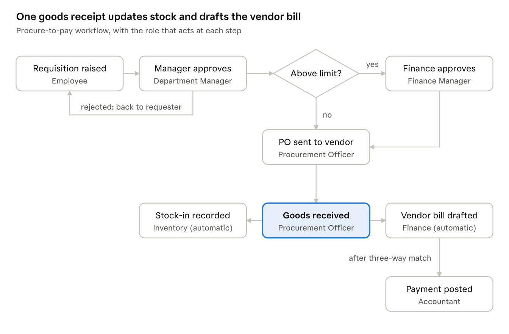
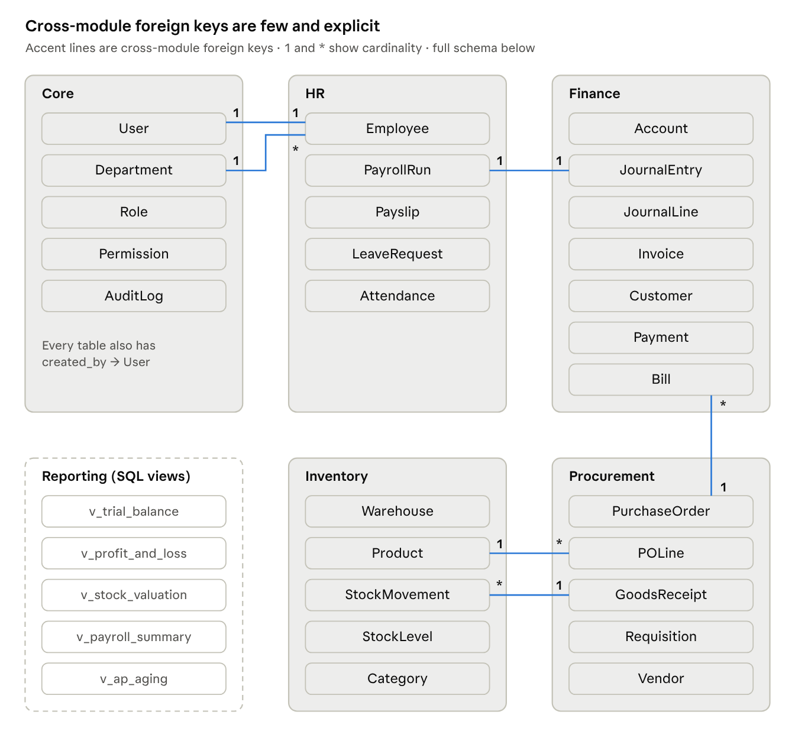
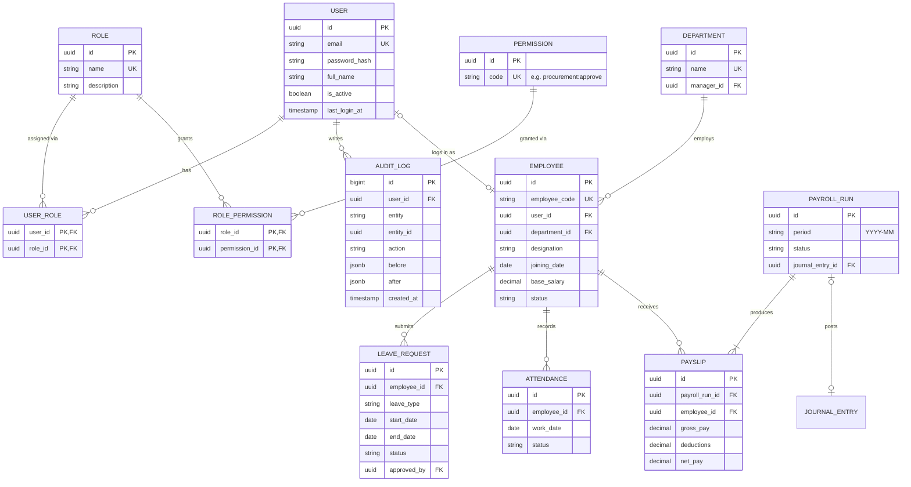
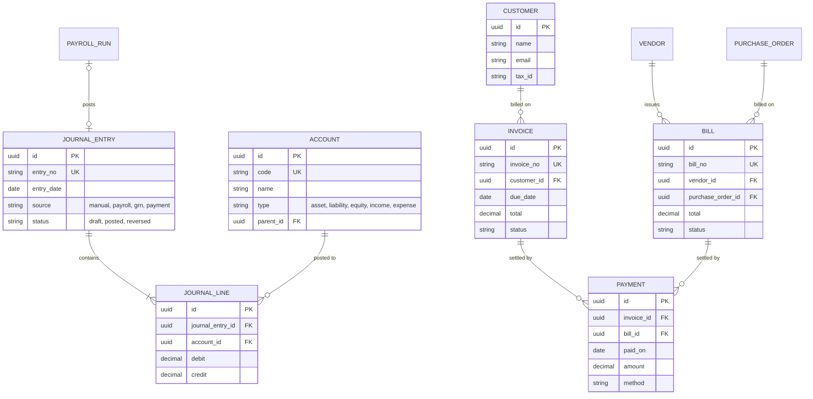
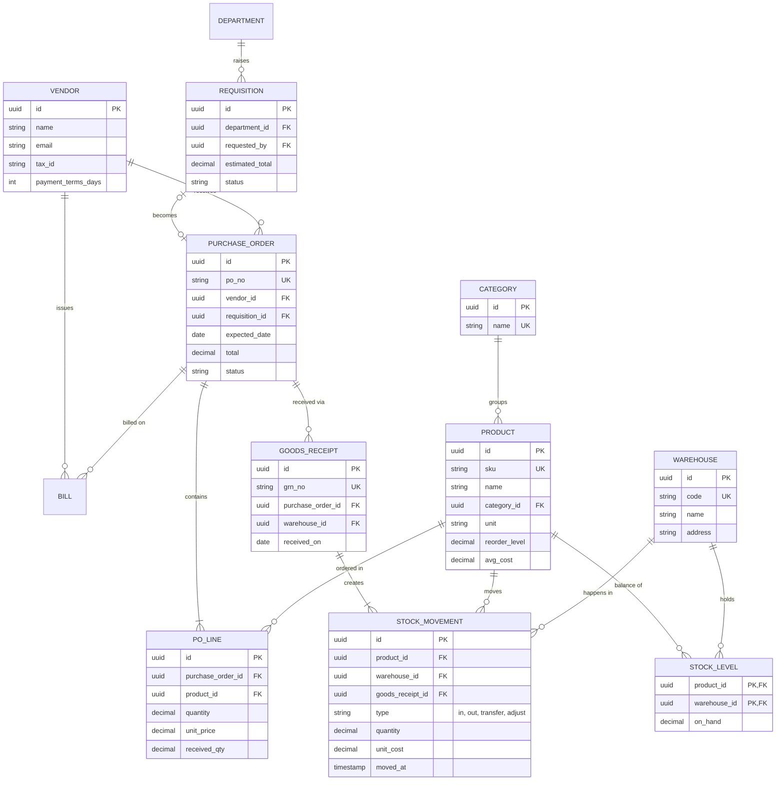
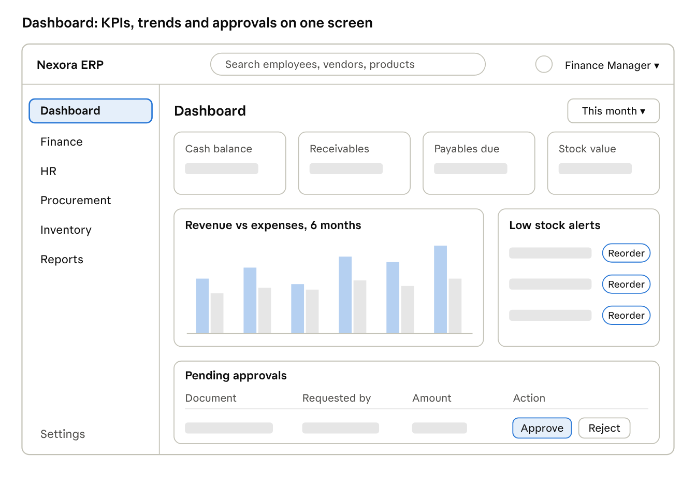
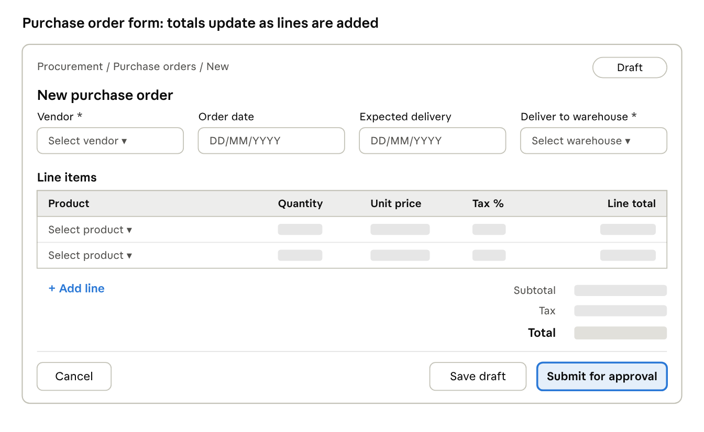
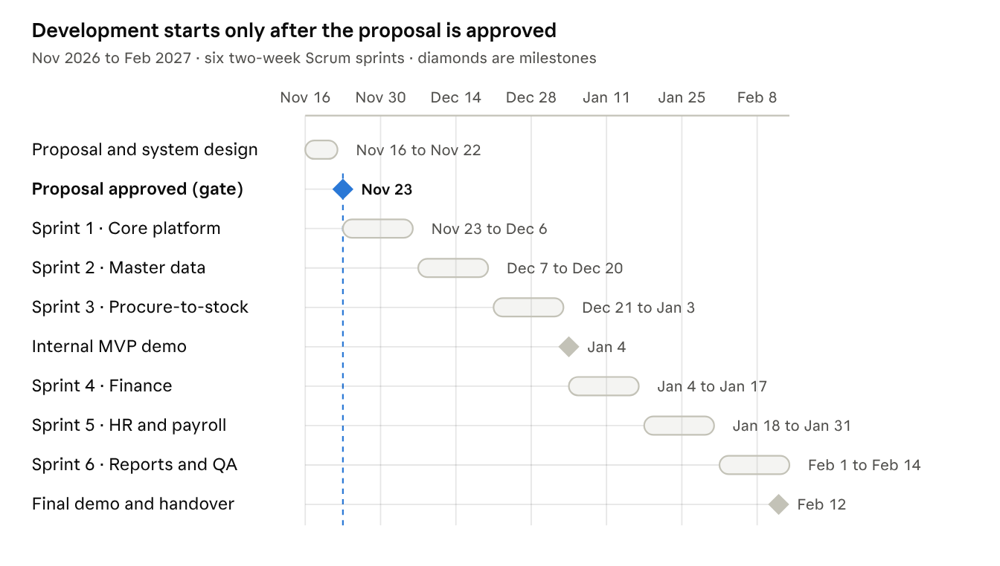

# Nexora ERP — Project Proposal & System Design

20 November 2026 · Naitik Raj · Remote internship · Business management software

## 1. Project overview and objectives

Nexora ERP is a web-based enterprise resource planning platform that gives small and mid-sized businesses one system for finance, HR, procurement, inventory and reporting. It replaces spreadsheets and disconnected tools with a single source of truth, role-based access and an audit trail on every business record.

**Problem.** Growing businesses run finance, payroll, purchasing and stock in separate tools. Data is re-keyed, numbers disagree between departments, and managers cannot see the state of the business without manual consolidation.

**Objectives**

1. Deliver five integrated modules (Finance, HR, Procurement, Inventory, Reporting) on one shared database and one login.
2. Automate cross-module flows: an approved purchase order raises stock on receipt and posts a payable to the ledger without re-entry.
3. Enforce role-based access control (RBAC) so each user sees and changes only what their role allows.
4. Give managers a live dashboard of key metrics (cash, payables, receivables, stock value, headcount).
5. Ship a tested, documented, deployed MVP by the end of the internship, with a clean Git history and CI pipeline.

**Success criteria**

- All Must-have requirements in section 3 pass their acceptance tests.
- Core API endpoints respond in under 500 ms (p95) with 10,000 seeded records per module.
- Unit and integration test coverage of at least 70% on backend services.
- A live demo deployment reachable by reviewers.

## 2. Project scope and boundaries

The MVP covers a single company with multiple departments and one base currency; anything needing external integrations or multi-company accounting is deferred.

| In scope (MVP) | Out of scope (future phases) |
| --- | --- |
| Single organisation, multiple departments and users | Multi-company / multi-tenant consolidation |
| One base currency, configurable tax rates | Multi-currency and exchange-rate revaluation |
| Chart of accounts, journals, invoices, bills, payments | Bank feed integration and automatic reconciliation |
| Employee records, leave, attendance, payroll run (gross to net, basic deductions) | Country-specific statutory payroll filing |
| Vendors, purchase requisitions, purchase orders, goods receipt | Vendor portal and e-procurement bidding |
| Products, warehouses, stock movements, reorder alerts | Barcode scanners, manufacturing / bill of materials |
| Dashboards, standard reports, CSV/PDF export | Custom report builder, AI forecasting |
| Responsive web app (desktop and tablet) | Native mobile apps |
| Email notifications for approvals | SMS, WhatsApp, Slack integrations |

**Boundaries and assumptions**

- Users access the system through a browser; no offline mode.
- Seed and demo data are synthetic; no real company or personal data is used.
- Payments are recorded, not processed: no payment gateway in the MVP.

## 3. Functional and non-functional requirements

Requirements are prioritised with MoSCoW (Must, Should, Could); every Must item is part of the MVP and has an acceptance test.

### Functional requirements

| ID | Module | Requirement | Priority |
| --- | --- | --- | --- |
| FR-01 | Core | Users sign in with email and password; sessions use short-lived access tokens and refresh tokens | Must |
| FR-02 | Core | Admin creates users, assigns roles and departments, and deactivates accounts | Must |
| FR-03 | Core | Every create, update and delete on a business record is written to an audit log (who, what, when, before/after) | Must |
| FR-04 | Finance | Maintain a chart of accounts and post double-entry journal entries that must balance | Must |
| FR-05 | Finance | Create customer invoices and vendor bills; record full or partial payments | Must |
| FR-06 | Finance | Produce trial balance, profit and loss, and balance sheet for any date range | Must |
| FR-07 | Finance | Define fiscal periods and lock closed periods against new postings | Should |
| FR-08 | HR | Maintain employee profiles, departments, designations and documents | Must |
| FR-09 | HR | Employees apply for leave; managers approve or reject | Must |
| FR-10 | HR | Record daily attendance and run monthly payroll (earnings, deductions, net pay, payslip PDF) | Must |
| FR-11 | HR | Payroll run posts a salary journal to Finance automatically | Should |
| FR-12 | Procurement | Maintain vendors; raise purchase requisitions that go through approval | Must |
| FR-13 | Procurement | Convert approved requisitions to purchase orders and email them to vendors | Must |
| FR-14 | Procurement | Record goods receipt against a PO (full or partial); matched receipt creates a vendor bill | Must |
| FR-15 | Inventory | Maintain products, categories, units and warehouses | Must |
| FR-16 | Inventory | Track stock in, out, transfer and adjustment movements with running balances per warehouse | Must |
| FR-17 | Inventory | Alert when stock falls below a product's reorder level | Should |
| FR-18 | Inventory | Value stock by weighted-average cost | Should |
| FR-19 | Reporting | Role-specific dashboard with key metrics and charts | Must |
| FR-20 | Reporting | Standard reports per module, filterable by date, department, warehouse; export to CSV and PDF | Must |
| FR-21 | Core | In-app and email notifications for pending approvals | Should |
| FR-22 | Core | Global search across employees, vendors, products and documents | Could |

### Non-functional requirements

| ID | Category | Requirement |
| --- | --- | --- |
| NFR-01 | Performance | p95 API response under 500 ms for list and detail endpoints; dashboard loads in under 2 s |
| NFR-02 | Scalability | Stateless API behind a load balancer; supports 200 concurrent users on one small instance |
| NFR-03 | Security | Passwords hashed with Argon2; HTTPS only; OWASP Top 10 mitigations; rate limiting on auth endpoints |
| NFR-04 | Authorisation | Every endpoint checks role permissions server-side; the UI only hides what the API already blocks |
| NFR-05 | Data integrity | Financial postings run in database transactions; journals cannot be edited after posting, only reversed |
| NFR-06 | Availability | 99.5% uptime target for the demo environment; daily automated database backups |
| NFR-07 | Usability | Responsive from 768 px up; WCAG 2.1 AA colour contrast and keyboard navigation |
| NFR-08 | Maintainability | Modular codebase, typed end to end (TypeScript), linted, at least 70% backend test coverage |
| NFR-09 | Observability | Structured JSON logs, request IDs, error tracking and a health-check endpoint |
| NFR-10 | Portability | Whole stack runs locally with one `docker compose up` command |

## 4. System modules and key features

Nexora is built as six modules: a Core platform that every business module depends on, plus five business modules that share data through it.

| Module | Purpose | Key features |
| --- | --- | --- |
| Core / Admin | Identity, access and shared services | Login, refresh tokens, user and role management, departments, company settings, audit log, notifications, file uploads |
| Finance | Record and report every money movement | Chart of accounts, journal entries, customer invoices, vendor bills, payments, tax rates, fiscal periods, trial balance, P&L, balance sheet |
| HR | Manage people and pay them | Employee directory, departments and designations, leave types and requests, attendance, salary structures, monthly payroll run, payslip PDFs |
| Procurement | Buy goods and services under control | Vendor master, purchase requisitions with approval, purchase orders, goods receipt notes, three-way match (PO, receipt, bill) |
| Inventory | Know what stock is where and what it is worth | Products and categories, units of measure, warehouses, stock movements (in, out, transfer, adjust), reorder alerts, weighted-average valuation |
| Reporting | Turn data into decisions | Role-based dashboards, KPI cards and charts, standard reports per module, filters, CSV and PDF export |

**Cross-module integrations**

- Goods receipt (Procurement) creates stock-in movements (Inventory) and a draft vendor bill (Finance).
- Payroll run (HR) posts a salary journal entry (Finance).
- Stock adjustments (Inventory) post an inventory gain or loss journal (Finance).
- Reporting reads from all modules through read-only queries and database views.

## 5. User roles and permissions

Access is role-based: each user has one or more roles, each role grants permissions of the form `module:action` (for example `procurement:approve`), and the API checks them on every request.

| Role | Who | Main responsibilities |
| --- | --- | --- |
| Super Admin | System owner | Company settings, users, roles, full access, audit log |
| Finance Manager | Head of accounts | Approves bills and payments, closes periods, views all financial reports |
| Accountant | Finance staff | Posts journals, invoices, bills, payments |
| HR Manager | Head of HR | Manages employees, approves leave, runs payroll |
| Procurement Officer | Buyer | Manages vendors, creates POs, records goods receipt |
| Inventory Manager | Store keeper | Manages products and warehouses, moves and adjusts stock |
| Department Manager | Any team lead | Raises and approves requisitions and leave for their team |
| Employee | Every staff member | Views own profile and payslips, applies for leave, raises requisitions |

**Permission matrix** (C = create, R = read, U = update, D = delete, A = approve; "own" = own records only; "team" = own department)

| Module | Super Admin | Finance Mgr | Accountant | HR Mgr | Procurement | Inventory Mgr | Dept Mgr | Employee |
| --- | --- | --- | --- | --- | --- | --- | --- | --- |
| Users and roles | CRUD | R | — | R | — | — | — | — |
| Finance | CRUDA | CRUDA | CRU | — | R (bills) | — | — | — |
| HR: employees | CRUD | R | — | CRUD | — | — | R (team) | R (own) |
| HR: leave | CRUDA | — | — | CRUDA | — | — | A (team) | CR (own) |
| HR: payroll | CRUDA | R | — | CRUDA | — | — | — | R (own payslip) |
| Procurement | CRUDA | RA (above limit) | R | — | CRU | R | CA (team) | C (requisition) |
| Inventory | CRUD | R | R | — | R | CRUD | R | — |
| Reports and dashboards | All | Finance, all summaries | Finance | HR | Procurement | Inventory | Team | Own |
| Audit log | R | R (finance) | — | R (HR) | — | — | — | — |

**Rules**

- Requisitions above a configurable amount need Finance Manager approval in addition to the Department Manager.
- Nobody approves their own requisition, leave request or payment (segregation of duties).
- Roles and their permissions are stored as data, so new roles need no code change.

## 6. Technology stack and development tools

The stack is TypeScript end to end: Next.js for the web app, NestJS for the API, PostgreSQL for data. This is fixed before development begins; any change goes through a reviewed proposal update.

| Layer | Technology | Why |
| --- | --- | --- |
| Frontend framework | Next.js 16 (App Router), React 19, TypeScript 5 | Server components, file-based routing, fast builds |
| UI | Tailwind CSS 4, shadcn/ui, Lucide icons | Accessible, consistent components with little custom CSS |
| Data fetching and state | TanStack Query, Zustand | Server-state caching; small client state store |
| Forms and validation | React Hook Form, Zod (schemas shared with the API) | One validation schema on both sides |
| Tables and charts | TanStack Table, Recharts | Sortable, paginated data grids; dashboard charts |
| Backend framework | NestJS 11 on Node.js 24 LTS | Modules, dependency injection and guards map cleanly onto ERP modules and RBAC |
| API style | REST (JSON), OpenAPI / Swagger docs | Simple to test and document; auto-generated API reference |
| ORM and migrations | Prisma 6 | Type-safe queries and versioned schema migrations |
| Database | PostgreSQL 17 | ACID transactions for accounting, strong relational model, views for reports |
| Cache and jobs | Redis 7 + BullMQ | Session revocation, caching, background jobs (payroll run, PDF generation, emails) |
| Authentication | JWT access token (15 min) + rotating refresh token in httpOnly cookie, Argon2 hashing | Stateless API with revocable sessions |
| File storage | S3-compatible object storage (MinIO locally) | Employee documents, attachments, generated PDFs |
| Email | Nodemailer via SMTP (Mailpit locally) | Approval and PO emails |
| PDF generation | Puppeteer (HTML to PDF) | Payslips, invoices, purchase orders |
| Testing | Jest (unit, integration), Supertest (API), Playwright (end-to-end) | Covers services, endpoints and user flows |
| Code quality | ESLint, Prettier, Husky + lint-staged, Commitlint | Consistent style and commit messages enforced before push |
| Containers | Docker, Docker Compose | Same environment for every developer and for CI |
| CI/CD | GitHub Actions | Lint, test, build on every pull request; deploy on merge to `main` |
| Hosting | Vercel (web), Render or Railway (API, PostgreSQL, Redis) | Free or low-cost tiers suitable for an internship demo |
| Monitoring | Sentry (errors), Pino (structured logs) | Error tracking and searchable logs |
| Design and docs | Figma (wireframes), dbdiagram.io (ERD), Swagger UI, Markdown docs in repo | Design and reference material kept next to code |
| Project management | GitHub Projects (Kanban), GitHub Issues | Backlog, sprints and progress in one place with the code |
| Editor | VS Code with ESLint, Prettier, Prisma and Docker extensions | Shared editor setup via `.vscode/extensions.json` |

## 7. System architecture and workflows

Nexora is a modular monolith: one Next.js web app calls one NestJS API over REST, and every request passes the same authentication and RBAC guard before it reaches a business module.



Each module owns its own tables, services and endpoints, and talks to other modules only through their service interfaces, never by reading their tables directly. Slow work (payroll runs, PDF generation, emails) is queued in BullMQ and processed by a background worker, so API responses stay fast.

**Why a modular monolith rather than microservices**

- One deployable and one database keep accounting transactions ACID across modules (a goods receipt updates stock and the ledger in one transaction).
- Clear module boundaries mean any module can be split into its own service later if load requires it.

### Key workflows



The goods receipt is the integration point: one confirmed receipt raises stock in the chosen warehouse and drafts the vendor bill, which is paid only after the PO, receipt and bill quantities and prices match.

**Request lifecycle (every API call)**

1. The browser sends the request with the access token; an expired token is silently refreshed using the httpOnly refresh cookie.
2. The auth guard verifies the token; the RBAC guard checks the user's permission for the route (e.g. `inventory:update`).
3. Zod validates the body; the module service runs the business rules inside a database transaction.
4. The audit interceptor writes the change to the audit log; the API returns JSON.

**Leave approval**

1. Employee submits a leave request; the system checks the remaining balance.
2. The Department Manager is notified and approves or rejects.
3. Approved leave reduces the balance and appears in attendance and payroll.

**Monthly payroll run**

1. HR Manager starts a run for the month; a background job calculates earnings, deductions and net pay from salary structures, attendance and unpaid leave.
2. HR Manager reviews and confirms; payslip PDFs are generated and employees notified.
3. Confirmation posts a salary journal entry to Finance (salary expense debit, payable credit).

**Period close**

1. Accountant reviews the trial balance; Finance Manager locks the fiscal period.
2. Locked periods reject new postings; corrections are made as reversing entries in the open period.

## 8. Database design and Entity Relationship Diagram (ERD)

Nexora uses one PostgreSQL 17 database in third normal form, with each module owning its own group of tables and only six business foreign keys crossing module boundaries (plus the created_by and updated_by audit columns that point to User).



The overview shows where each table lives; the detailed ERD below lists every table's key columns and all relationships.

### Detailed ERD

#### ERD: Core and HR



#### ERD: Finance



#### ERD: Procurement and Inventory



### Design rules

| Rule | Detail |
| --- | --- |
| Keys | UUID primary keys (`uuid` v7 for index-friendly ordering); human-readable numbers such as `PO-2026-0001` in separate unique columns |
| Money and quantities | `NUMERIC(14,2)` for money, `NUMERIC(14,3)` for quantities; never floating point |
| Common columns | Every table has `created_at`, `updated_at`, `created_by`, `updated_by`; master data has `deleted_at` for soft delete |
| Double entry | A database check plus service rule: the sum of debits equals the sum of credits for every posted journal entry |
| Immutability | Posted journals, payslips and stock movements are never updated; corrections are reversing records |
| Stock balances | `STOCK_LEVEL` is updated in the same transaction as each `STOCK_MOVEMENT`, so on-hand quantity is always consistent |
| Indexes | Foreign keys, status columns and date columns used in report filters (e.g. `journal_entry.entry_date`, `stock_movement.moved_at`) |
| Migrations | Versioned Prisma migrations committed to Git; seed script loads roles, permissions, chart of accounts and demo data |

## 9. UI/UX wireframes and interface design

Every screen uses one app shell (top bar, module sidebar, content area), so users learn the layout once; the two low-fidelity wireframes below set the pattern for dashboards and data-entry forms. High-fidelity screens will be built in Figma during Sprint 1.

### Dashboard



KPI cards and widgets change with the signed-in role: an HR Manager sees headcount, leave and payroll cost instead of cash and payables. Approvals can be actioned directly from the dashboard.

### Data-entry form



All forms follow this pattern: required fields marked *, inline validation as the user types, line totals calculated live, and a status chip (Draft, Pending approval, Approved, Received, Closed) showing where the document is in its workflow.

### Screen inventory

| Module | Screens |
| --- | --- |
| Core | Login, forgot password, user list and form, roles and permissions editor, company settings, audit log viewer, notifications panel |
| Finance | Chart of accounts, journal entry form, invoices list and form, bills list and form, payments, fiscal periods, financial statements |
| HR | Employee directory, employee profile, leave requests and approvals, attendance sheet, salary structures, payroll run wizard, payslip view |
| Procurement | Vendors list and profile, requisition form, approvals queue, purchase order list and form, goods receipt form |
| Inventory | Products list and form, categories, warehouses, stock movements, stock levels by warehouse, reorder alerts |
| Reporting | Role dashboard, report catalogue, report viewer with filters, CSV and PDF export |

### Design principles

- **Consistency:** shadcn/ui components and one design token set (colours, spacing, type) for every module.
- **Data first:** tables with sorting, filtering, pagination and saved column choices; bulk actions where useful.
- **Clear status:** every document shows its workflow state and the next action available to the current user.
- **Accessibility:** WCAG 2.1 AA contrast, full keyboard navigation, visible focus states, labelled form fields.
- **Responsive:** sidebar collapses to icons below 1024 px and to a menu below 768 px.
- **Light and dark themes** from the same tokens.

## 10. Development methodology and project timeline

The project follows Agile Scrum in six two-week sprints over 13 weeks, with week 1 reserved for this proposal and no feature code written until it is approved.



The timeline assumes a 13-week internship starting 16 Nov 2026 and approval on 23 Nov; if approval lands later, every sprint shifts by the same amount.

**Scrum practices (adapted for a remote internship)**

- **Sprint planning** at the start of each sprint: pick issues from the prioritised backlog on GitHub Projects.
- **Daily async stand-up:** a short written update (done, next, blockers) in the team channel.
- **Sprint review** with the mentor: live demo of the sprint's working features on the staging environment.
- **Retrospective:** one change to try in the next sprint, recorded in `docs/retros.md`.
- **Definition of done:** code reviewed and merged, tests passing in CI, API documented in Swagger, deployed to staging.

**Sprint deliverables**

| Sprint | Deliverables | Exit criteria |
| --- | --- | --- |
| Week 1 | Proposal, system design, ERD, wireframes | Proposal approved by reviewer |
| Sprint 1 | Monorepo, Docker, CI pipeline, database schema, login and refresh tokens, RBAC, user and role admin, audit log, app shell UI | Users sign in and see only menus their role allows |
| Sprint 2 | Departments, employees, vendors, customers, products, categories, warehouses (CRUD screens and APIs) | All master data can be created, searched and edited |
| Sprint 3 | Requisitions with approval, purchase orders, goods receipt, stock movements and stock levels, reorder alerts | Full requisition-to-stock flow works end to end (internal MVP demo) |
| Sprint 4 | Chart of accounts, journals, invoices, bills, payments, GRN-to-bill link, financial statements | Trial balance balances on seeded data; P&L and balance sheet generate |
| Sprint 5 | Leave, attendance, salary structures, payroll run, payslip PDFs, payroll journal | Payroll for 50 seeded employees runs and posts to the ledger |
| Sprint 6 | Dashboards, reports, CSV/PDF export, performance and security testing, Playwright E2E suite, production deployment, documentation | All Must requirements pass; final demo delivered |

**Risks and mitigations**

| Risk | Mitigation |
| --- | --- |
| Scope is large for 13 weeks | MoSCoW priorities: Should and Could items move to a later phase before Must items slip |
| Accounting logic errors | Double-entry rules enforced in the database and covered by unit tests with worked examples |
| Late approval delays the start | Sprint 1 setup tasks (repo, CI, Docker) are ready to start the day approval arrives |
| Free hosting tiers sleep or limit resources | Demo seeded and warmed before reviews; Docker setup lets reviewers run it locally |

## 11. GitHub repository and version control plan

All code lives in one GitHub monorepo, `nexora-erp`, with protected `main` and `develop` branches; every change reaches them through a reviewed pull request that passes CI.

**Repository link:** [github.com/naitik-raj17/nexora-erp](https://github.com/naitik-raj17/nexora-erp) (public; `main` and `develop` branches, CI workflow and PR/issue templates in place).

**Repository structure**

```
nexora-erp/
├── apps/
│   ├── web/            # Next.js frontend
│   └── api/            # NestJS backend (src/modules/finance, hr, procurement, inventory, reporting, core)
├── packages/
│   ├── shared/         # Zod schemas, types, constants shared by web and api
│   └── config/         # ESLint, TypeScript, Prettier presets
├── prisma/             # schema.prisma, migrations, seed scripts
├── docs/               # proposal, ERD, API notes, ADRs
├── .github/            # workflows, PR and issue templates, CODEOWNERS
├── docker-compose.yml
└── README.md
```

The monorepo uses pnpm workspaces and Turborepo for cached builds.

**Branching strategy (simplified Git Flow)**

| Branch | Purpose | Rules |
| --- | --- | --- |
| `main` | Production-ready, deployed code | Protected; merge only from `develop` or `hotfix/*` via PR; tagged per release |
| `develop` | Integration branch for the current sprint | Protected; merge from feature branches via PR; auto-deploys to staging |
| `feature/<issue-id>-<short-name>` | One issue or user story, e.g. `feature/42-purchase-order-form` | Branched from `develop`; deleted after merge |
| `fix/<issue-id>-<short-name>` | Bug fix found during a sprint | Branched from `develop` |
| `hotfix/<short-name>` | Urgent fix on production | Branched from `main`; merged back to `main` and `develop` |

**Commit convention** — Conventional Commits, enforced by Commitlint: `feat(procurement): add goods receipt form`, `fix(finance): reject unbalanced journal`, `docs: update ERD`, `test(hr): payroll net pay cases`, `chore: bump dependencies`.

**Pull request workflow**

1. Open an issue on the GitHub Projects board; move it to In Progress.
2. Create a feature branch from `develop`; commit small, focused changes.
3. Open a PR using the template (summary, linked issue, screenshots, test notes).
4. CI runs lint, type check, unit and integration tests, and build; all must pass.
5. At least one reviewer (mentor or peer) approves; squash-merge to `develop`.
6. At sprint end, `develop` is merged into `main` and tagged with semantic versioning (`v0.1.0`, `v0.2.0` …).

**Repository hygiene**

- Secrets only in GitHub Actions secrets and local `.env` files; `.env` is git-ignored and `.env.example` is committed.
- Dependabot keeps dependencies current; CodeQL scans for vulnerabilities.
- `CHANGELOG.md` is generated from commit messages at each release.
- README covers setup, scripts, architecture summary and demo credentials.

**Repository contents (week 1)**

The repository already holds every document and configuration this proposal mentions; application code starts in Sprint 1 after approval.

| Path | Contents |
| --- | --- |
| `README.md` | Project summary, all proposal sections in brief, setup steps, document index |
| `docs/Nexora-ERP-Proposal-and-System-Design.pdf` | This document |
| `docs/proposal.md` | This document in Markdown, readable on GitHub |
| `docs/architecture.md` | Architecture, module boundaries, workflows, deployment environments |
| `docs/erd.md` | Module overview, cross-module keys, detailed ERDs (Mermaid), design rules |
| `docs/adr/` | Architecture decision records: modular monolith, technology stack, authentication and RBAC |
| `docs/images/` | Architecture, workflow, ERD, wireframe and timeline diagrams |
| `docs/retros.md` | Sprint retrospective log |
| `CONTRIBUTING.md` | Setup, branching, commit convention, PR workflow, definition of done |
| `CHANGELOG.md` | Release notes (Keep a Changelog format) |
| `docker-compose.yml`, `.env.example` | Local PostgreSQL 17, Redis 7, MinIO and Mailpit; environment variable template |
| `package.json`, `pnpm-workspace.yaml`, `turbo.json` | pnpm workspaces and Turborepo pipeline (dev, build, lint, typecheck, test) |
| `packages/config/` | Shared ESLint, TypeScript and Prettier presets |
| `commitlint.config.mjs`, `.husky/`, `.lintstagedrc.json`, `.prettierrc.json` | Commit message and formatting checks on every commit |
| `.github/` | CI and CodeQL workflows, Dependabot, CODEOWNERS, PR and issue templates |
| `.vscode/extensions.json`, `.editorconfig`, `.nvmrc` | Shared editor setup and Node.js version |
| `apps/web`, `apps/api`, `packages/shared`, `prisma/` | Planned packages, each with a README describing what Sprint 1 adds |

Sprint milestones (Sprint 1 to Sprint 6) and module labels are set up in GitHub Issues to track the backlog.
